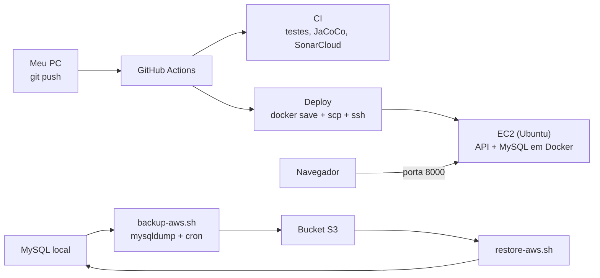

# Voll.med API · CI/CD com GitHub Actions e deploy na AWS

[](https://github.com/naeffm/vollmed-api/actions/workflows/integracao-continua.yml)
[](https://github.com/naeffm/vollmed-api/actions/workflows/deploy.yml)

Projeto de estudo de **DevOps**: uma API REST em Java (Spring Boot + MySQL) com pipeline de integração contínua, deploy automático numa instância **EC2** da AWS e **backup do banco no S3**.

A cada `git push` na `main`, o código é testado, analisado e publicado no servidor, sem ninguém entrar na máquina.

> A API (código Java) foi desenvolvida pela Alura. A infraestrutura deste repositório (containers, pipelines, scripts de deploy e backup, configuração da AWS) foi o meu trabalho.

---

## Arquitetura



---

## Stack

| Área | Ferramentas |
|---|---|
| Aplicação | Java 17, Spring Boot 3, Maven, MySQL 8, Flyway |
| Containers | Docker, Docker Compose |
| CI/CD | GitHub Actions, JaCoCo, SonarCloud |
| Nuvem | AWS EC2, S3, IAM, Security Groups |
| Automação | Bash, SSH/SCP, cron |

---

## Pipeline de CI · [`integracao-continua.yml`](.github/workflows/integracao-continua.yml)

Roda em todo push e pull request na `main`:

1. Prepara o runner com **Java 17 (Temurin)** e cache do Maven
2. Sobe a API e o MySQL com `docker compose`
3. Compila e roda os testes com `mvn verify`
4. Gera o relatório de cobertura com **JaCoCo**
5. Envia a análise estática pro **SonarCloud** (token guardado em secret)

---

## Deploy na EC2 · [`deploy.yml`](.github/workflows/deploy.yml) + [`script-deploy.sh`](script-deploy.sh)

```
runner do GitHub                               EC2
────────────────                               ───
docker compose up   → constrói a imagem
docker save         → imagem vira vollmed-api.tar
scp                 → copia .tar, init.sql,  ─────→  /home/ubuntu
                      compose de produção e script
ssh                 → executa o script       ─────→  docker load
                                                     para os containers antigos
                                                     docker compose up -d
```

- A chave SSH da EC2 fica no secret `EC2_PRIVATE_KEY`; o runner recria o arquivo `.pem` com `chmod 600` só durante a execução.
- O compose de produção usa `image:` em vez de `build:`: o código-fonte não vai pro servidor, só a imagem pronta.
- O **Security Group** libera a porta 22 (SSH) e a 8000 (API). A 3306 (MySQL) fica restrita ao meu IP.

---

## Backup e restore do banco no S3 · [`scripts/`](scripts/)

| Script | O que faz |
|---|---|
| `backup-aws.sh` | Gera um `.sql` por tabela com `mysqldump`, numa pasta com a data do dia, e envia pro S3 com `aws s3 sync` |
| `restore-aws.sh <data> <tabela>` | Baixa do S3 o backup daquela data e restaura a tabela no MySQL |

- As credenciais do MySQL ficam num `~/.my.cnf` com `chmod 600`, fora do código.
- O backup usa um usuário MySQL só de leitura, e o acesso ao S3 usa um usuário **IAM** próprio.
- O agendamento diário é feito com **cron**:

```cron
0 2 * * * /home/naeffm/vollmed-api/scripts/backup-aws.sh vollmed_db >> /home/naeffm/backup.log 2>&1
```

Testado na prática: apaguei a tabela `medicos` e restaurei os 100 registros a partir do backup no S3.

---

## Problemas que resolvi

O material do curso tinha alguns anos, e várias peças tinham mudado. Cada problema abaixo foi resolvido lendo os logs (GitHub Actions, `docker logs`, `dmesg`).

| Sintoma | Causa | Correção |
|---|---|---|
| `openjdk:17: not found` | imagem oficial descontinuada no Docker Hub | `eclipse-temurin:17-jdk` |
| Actions com avisos de versão | `checkout` e `setup-java` em `v3` | atualizado pra `v4` |
| `No plugin found for prefix 'sonar'` | plugin do Sonar fora do `pom.xml` | chamada pelo nome completo do plugin |
| `pull access denied for vollmed-api_api` | o Compose v2 nomeia imagens com hífen (`vollmed-api-api`), o curso usava o v1 | mesmo nome no `docker save` e no compose de produção |
| `Unable to acquire JDBC Connection` | o Linux matava o MySQL por falta de memória (EC2 com 908 MB e sem swap) | swap de 1 GB |
| Banco exposto na internet | porta 3306 aberta pra `0.0.0.0/0` | Security Group restrito ao meu IP |
| Disco da EC2 enchendo | cada deploy deixa uma imagem antiga | `docker image prune` |
| `externally-managed-environment` | o Ubuntu bloqueia `sudo pip install` (PEP 668) | AWS CLI v2 pelo snap oficial |

---

## Rodando localmente

```bash
git clone https://github.com/naeffm/vollmed-api.git
cd vollmed-api
docker compose up -d
```

A API sobe em `http://localhost:8000`. Uma resposta **403** é o esperado: as rotas exigem autenticação (Spring Security + JWT).

---

## Status da infraestrutura

A EC2 de demonstração pode estar desligada pra não gerar custo. Nesse caso, o workflow de deploy falha na etapa de conexão; o CI continua funcionando normalmente.

---

## Créditos

API desenvolvida pela [Alura](https://www.alura.com.br) para os cursos de Spring Boot (instrutor: [Rodrigo Ferreira](https://cursos.alura.com.br/user/rodrigo-ferreira)). Pipelines, deploy e backup desenvolvidos durante o curso *Scripting: crie pipelines com GitHub Actions para deploy na AWS*.
